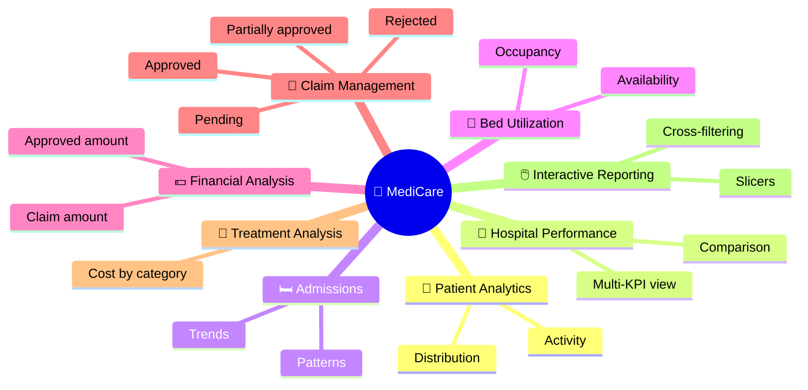

<div align="center">


<a href="https://github.com/harsh-mish">
  
</a>

<br/><br/>


<br/>


<br/><br/>

### 🩺 An end-to-end healthcare analytics project to monitor **hospital performance**, **patient activity**, **financial claims** and **treatment costs** through interactive Power BI dashboards.

</div>


## 🧭 Table of Contents

<div align="center">

| 🟦 | Section | 🟩 | Section | 🟧 | Section |
|:-:|---------|:-:|---------|:-:|---------|
| 1 | [🔍 Overview](#-project-overview) | 7 | [📊 Dashboard Overview](#-dashboard-overview) | 13 | [📁 Project Structure](#-project-structure) |
| 2 | [🎯 Objectives](#-project-objectives) | 8 | [📸 Screenshots](#-screenshots) | 14 | [🚀 How to Use](#-how-to-use) |
| 3 | [🛠️ Tools](#️-tools--technologies) | 9 | [📈 KPIs](#-key-performance-indicators) | 15 | [📚 Skills Demonstrated](#-skills-demonstrated) |
| 4 | [🏗️ Architecture](#️-architecture--workflow) | 10 | [🧮 DAX Measures](#-sample-dax-measures) | 16 | [🔮 Future Enhancements](#-future-enhancements) |
| 5 | [📂 Dataset](#-dataset-overview) | 11 | [💡 Insights](#-key-business-insights) | 17 | [⚠️ Disclaimer](#️-disclaimer) |
| 6 | [🧩 Data Model](#-data-model) | 12 | [🎨 Design Highlights](#-design--ux-highlights) | 18 | [👨‍💻 Author](#-author) |

</div>


## 🔍 Project Overview

> [!NOTE]
> **MediCare** turns scattered healthcare records into one clear, interactive story.

Hospitals generate huge volumes of data every day: **patients, admissions, appointments, treatments, doctors, departments, bed utilization and insurance claims**. On their own these tables say very little. Together, inside a well-structured model, they show how a healthcare organization is really performing.

This project brings all of these datasets into a **star-schema data model** and presents them through a **two-page Power BI report** built for decision makers.

### ✨ What the solution helps stakeholders understand

<table>
<tr>
<td width="33%" valign="top">

#### 🏥 Operations
🟦 Overall hospital performance<br/>
🟦 Patient & admission trends<br/>
🟦 Appointment & treatment activity<br/>
🟦 Hospital-wise bed occupancy

</td>
<td width="33%" valign="top">

#### 💰 Finance
🟩 Insurance claim distribution<br/>
🟩 Claim approval performance<br/>
🟩 Treatment cost by category<br/>
🟩 Claimed vs approved amounts

</td>
<td width="33%" valign="top">

#### ⭐ Experience
🟧 Patient ratings & feedback<br/>
🟧 Department-wise satisfaction<br/>
🟧 Hospital-to-hospital comparison<br/>
🟧 Year-wise movement of ratings

</td>
</tr>
</table>

> [!TIP]
> 🎯 **Primary goal:** support **data-driven decision-making** and give clear visibility into healthcare operations.


## 🎯 Project Objectives



| | 🎯 Objective | 📝 Description |
|:-:|--------------|----------------|
| 🟦 | **Patient Analytics** | Monitor patient distribution and activity. |
| 🟩 | **Hospital Performance** | Compare performance across hospitals. |
| 🟨 | **Admission Analysis** | Understand admission trends and patterns over time. |
| 🟧 | **Bed Utilization** | Monitor hospital bed occupancy and availability. |
| 🟥 | **Financial Analysis** | Analyse claim amounts and approved amounts. |
| 🟪 | **Claim Management** | Track approved, pending, rejected and partially approved claims. |
| 🟫 | **Treatment Analysis** | Evaluate treatment costs by treatment category. |
| ⬛ | **Interactive Reporting** | Let users explore insights through slicers and cross-filtering visuals. |


## 🛠️ Tools & Technologies

<div align="center">


</div>

| | Technology | Purpose |
|:-:|------------|---------|
| 🟦 | **Microsoft Fabric** | Data engineering and lakehouse environment |
| 🟨 | **Power BI** | Interactive dashboard development |
| 🟪 | **DAX** | Measures, calculations and KPIs |
| 🔵 | **Power Query** | Data transformation and preparation |
| 🐬 | **SQL** | Data querying and analysis |
| 🔥 | **PySpark** | Data processing and transformation |


## 🏗️ Architecture & Workflow

```mermaid
%%{init: {'theme':'base','themeVariables':{'fontSize':'15px','lineColor':'#14B8A6'}}}%%
flowchart LR
    A["🧪 Generated<br/>Healthcare Data"] --> B["🔥 PySpark Notebooks<br/>Microsoft Fabric"]
    B --> C["🏠 Lakehouse<br/>Tables"]
    C --> D["🧹 Power Query<br/>Transformation"]
    D --> E["🧩 Star Schema<br/>Data Model"]
    E --> F["🧮 DAX Measures<br/>& KPIs"]
    F --> G["📊 Power BI<br/>Dashboard"]

    style A fill:#8B5CF6,color:#fff,stroke:#6D28D9,stroke-width:2px
    style B fill:#E25A1C,color:#fff,stroke:#B45309,stroke-width:2px
    style C fill:#0078D4,color:#fff,stroke:#1D4ED8,stroke-width:2px
    style D fill:#00A4EF,color:#fff,stroke:#0284C7,stroke-width:2px
    style E fill:#0D9488,color:#fff,stroke:#0F766E,stroke-width:2px
    style F fill:#EC4899,color:#fff,stroke:#BE185D,stroke-width:2px
    style G fill:#F2C811,color:#000,stroke:#CA8A04,stroke-width:2px
```



### 🪜 Step-by-step

| Step | | What happens |
|:----:|:-:|--------------|
| **1** | 🧪 | **Generate data:** create realistic synthetic healthcare datasets. |
| **2** | 🔥 | **Process & store:** transform with PySpark and keep in a Fabric Lakehouse. |
| **3** | 🧹 | **Prepare:** clean and shape the tables with Power Query. |
| **4** | 🧩 | **Model:** build fact and dimension tables with proper relationships. |
| **5** | 🧮 | **Calculate:** write DAX measures for every KPI. |
| **6** | 📊 | **Visualize:** design two polished report pages with slicers and cross-filtering. |


## 📂 Dataset Overview

The project uses **generated (synthetic) healthcare data** covering the main areas of hospital operations.

### 🔢 Dataset at a Glance

<div align="center">


<br/>


</div>

> [!NOTE]
> Record counts represent the generated project datasets and may vary after filtering or data cleaning.

### 📚 Main Tables

| | 📋 Table | 📝 Description |
|:-:|----------|----------------|
| 🟦 | **Patients** | Patient demographics and registration information |
| 🟩 | **Hospitals** | Hospital details and location information |
| 🟨 | **Departments** | Hospital department information |
| 🟧 | **Doctors** | Doctor details and specializations |
| 🟥 | **Admissions** | Patient admission and discharge records |
| 🟪 | **Appointments** | Appointment details and waiting times |
| 🟫 | **Treatments** | Treatment types and treatment costs |
| 🔵 | **Insurance Claims** | Insurance claim amounts and approval details |
| 🟢 | **Bed Utilization** | Total, occupied and available beds |
| 🟡 | **Patient Feedback** | Patient ratings and feedback categories |


## 🧩 Data Model

The report follows a **star schema**: fact tables hold the measurable events, and dimension tables give the context used for slicing and filtering.

<table>
<tr>
<td width="50%" valign="top">

### 🟧 Fact Tables

| Table | Captures |
|-------|----------|
| `Fact Admissions` | Admission & discharge events |
| `Fact Appointments` | Appointments & waiting times |
| `Fact Treatments` | Treatment types & costs |
| `Fact Insurance Claims` | Claimed/approved amounts, status |
| `Fact Bed Utilization` | Total, occupied, available beds |
| `Fact Patient Feedback` | Ratings & feedback categories |

</td>
<td width="50%" valign="top">

### 🟩 Dimension Tables

| Table | Role |
|-------|------|
| `Dim Patient` | Who received care |
| `Dim Hospital` | Where care was delivered |
| `Dim Department` | Which department |
| `Dim Doctor` | Who provided care |
| `Dim Date` | When it happened |

```mermaid
%%{init: {'theme':'base','themeVariables':{'lineColor':'#94A3B8'}}}%%
flowchart TB
    DP["🧑 Dim Patient"]
    DH["🏥 Dim Hospital"]
    DD["🏢 Dim Department"]
    DR["👨‍⚕️ Dim Doctor"]
    DT["📅 Dim Date"]

    FA["🛏️ Fact Admissions"]
    FP["📅 Fact Appointments"]
    FT["💊 Fact Treatments"]
    FC["🧾 Fact Insurance Claims"]
    FB["🛌 Fact Bed Utilization"]
    FF["⭐ Fact Patient Feedback"]

    DP --> FA & FP & FT & FC & FF
    DH --> FA & FB & FF
    DD --> FA & FP & FF
    DR --> FP & FT
    DT --> FA & FP & FT & FC & FB

    style DP fill:#0D9488,color:#fff,stroke:#0F766E,stroke-width:2px
    style DH fill:#16A34A,color:#fff,stroke:#166534,stroke-width:2px
    style DD fill:#0284C7,color:#fff,stroke:#075985,stroke-width:2px
    style DR fill:#7C3AED,color:#fff,stroke:#5B21B6,stroke-width:2px
    style DT fill:#DB2777,color:#fff,stroke:#9D174D,stroke-width:2px
    style FA fill:#F59E0B,color:#000,stroke:#B45309,stroke-width:2px
    style FP fill:#F97316,color:#000,stroke:#C2410C,stroke-width:2px
    style FT fill:#EF4444,color:#fff,stroke:#B91C1C,stroke-width:2px
    style FC fill:#EAB308,color:#000,stroke:#A16207,stroke-width:2px
    style FB fill:#84CC16,color:#000,stroke:#4D7C0F,stroke-width:2px
    style FF fill:#FB7185,color:#000,stroke:#BE123C,stroke-width:2px
```

</td>
</tr>
</table>



> [!IMPORTANT]
> 🔗 The model is built for **one-to-many relationships** and smooth **cross-filtering** between related healthcare entities.


## 📊 Dashboard Overview

The MediCare report is organized into **two analytical pages**.

<table>
<tr>
<td width="50%" valign="top">

### 🏠 Page 1 · Executive Overview


A high-level command center for hospital operations and performance.

**🟦 KPI Cards**
- Total Patients
- Total Admissions
- Total Appointments
- Total Treatments
- Average Patient Rating

**🟩 Visuals**
- Admission Trends
- Hospital-wise Bed Occupancy Rate
- Hospital Comparison

**🟧 Slicers**
- Year · Hospital Name
- Department Name
- Insurance Type · Hospital Type

</td>
<td width="50%" valign="top">

### 💰 Page 2 · Financial & Claims


A focused view of claim performance and treatment costs.

**🟦 KPI Cards**
- Total Claim Amount
- Approved Amount
- Total Treatment Cost
- Claim Approval Rate

**🟩 Visuals**
- Claims by Status
- Claim Amount vs Approved Amount
- Monthly Claim Trends
- Treatment Cost by Treatment Type
- Claim Status Summary

**🟧 Slicers**
- Year · Month Name
- Claim Status · Treatment Type

</td>
</tr>
</table>


## 📸 Screenshots

### 🏠 Executive Overview


### 💰 Financial & Claims Analysis


## 📈 Key Performance Indicators

<div align="center">


<br/>


<br/>


</div>

<br/>

| | 📌 KPI | 🎯 Business Purpose | 📄 Page |
|:-:|--------|---------------------|:-------:|
| 🟦 | **Total Patients** | Measures the overall patient population | 🏠 Executive |
| 🟦 | **Total Admissions** | Tracks hospital admission activity | 🏠 Executive |
| 🟦 | **Total Appointments** | Measures appointment volume | 🏠 Executive |
| 🟦 | **Total Treatments** | Tracks treatment activity | 🏠 Executive |
| 🟨 | **Average Rating** | Measures patient satisfaction | 🏠 Executive |
| 🟩 | **Bed Occupancy Rate** | Evaluates hospital bed utilization | 🏠 Executive |
| 🟥 | **Total Claim Amount** | Total value of insurance claims | 💰 Financial |
| 🟥 | **Approved Amount** | Amount approved by insurers | 💰 Financial |
| 🟧 | **Claim Approval Rate** | Proportion of approved claims | 💰 Financial |
| 🟪 | **Total Treatment Cost** | Evaluates treatment-related costs | 💰 Financial |


## 🧮 Sample DAX Measures

> [!TIP]
> Example patterns for the KPIs above. Adjust table and column names to match your model.

<details open>
<summary><b>🟦 Executive Overview measures</b></summary>

```DAX
Total Patients = DISTINCTCOUNT ( 'Dim Patient'[PatientID] )

Total Admissions = COUNTROWS ( 'Fact Admissions' )

Average Rating = AVERAGE ( 'Fact Patient Feedback'[Rating] )

Bed Occupancy Rate % =
DIVIDE (
    SUM ( 'Fact Bed Utilization'[OccupiedBeds] ),
    SUM ( 'Fact Bed Utilization'[TotalBeds] )
)
```

</details>

<details open>
<summary><b>🟧 Financial & Claims measures</b></summary>

```DAX
Total Claim Amount = SUM ( 'Fact Insurance Claims'[ClaimAmount] )

Approved Amount = SUM ( 'Fact Insurance Claims'[ApprovedAmount] )

Claim Approval Rate % =
DIVIDE (
    CALCULATE (
        COUNTROWS ( 'Fact Insurance Claims' ),
        'Fact Insurance Claims'[ClaimStatus] = "Approved"
    ),
    COUNTROWS ( 'Fact Insurance Claims' )
)

Total Treatment Cost = SUM ( 'Fact Treatments'[TreatmentCost] )
```

</details>


## 💡 Key Business Insights

The dashboard helps answer questions like these:

| # | ❓ Question | 📄 Where to find it |
|:-:|------------|:-------------------:|
| 1️⃣ | Which hospital has the highest patient volume? | 🏠 Executive |
| 2️⃣ | How do admissions change over time? | 🏠 Executive |
| 3️⃣ | Which hospital has the highest bed occupancy rate? | 🏠 Executive |
| 4️⃣ | Which hospitals have comparatively higher admission activity? | 🏠 Executive |
| 5️⃣ | What proportion of claims are approved, pending or rejected? | 💰 Financial |
| 6️⃣ | How does the approved amount compare with the total claim amount? | 💰 Financial |
| 7️⃣ | Which treatment category contributes the highest treatment cost? | 💰 Financial |
| 8️⃣ | How do claim amounts change across different months? | 💰 Financial |
| 9️⃣ | How does patient feedback vary across departments? | 🏠 Executive |
| 🔟 | How can hospital performance be compared using multiple KPIs? | 🏠💰 Both |


## 🎨 Design & UX Highlights

| | Feature | Why it matters |
|:-:|---------|----------------|
| 🎛️ | **Slicer-driven exploration** | Filter by year, hospital, department, insurance type, claim status and more. |
| 🔄 | **Cross-filtering visuals** | Click any chart element to update the rest of the page. |
| 🧭 | **Two-page storytelling** | Operations first, finance second. |
| 🎨 | **Consistent healthcare theme** | Teal-based palette with KPI cards for quick scanning. |
| 🧱 | **Reusable star-schema model** | Easy to extend with new facts or dimensions. |


## 📁 Project Structure

```text
MediCare-Healthcare-Analytics/
│
├── 📊 Dashboard/
│   └── MediCare_Dashboard.pbix
│
├── 🖼️ Screenshots/
│   ├── Executive_Overview.png
│   └── Financial_Claims_Analysis.png
│
├── 📂 Data/
│   └── Dataset_Information.md
│
├── 🐬 SQL/
│   └── SQL_Queries.sql
│
├── 🔥 Notebooks/
│   └── Data_Transformation_Notebooks/
│
└── 📘 README.md
```

> [!NOTE]
> Include only the folders and files that are actually available in your repository.


## 🚀 How to Use

<table>
<tr>
<td align="center" width="14%">📥<br/><b>1</b><br/>Clone / download the repo</td>
<td align="center" width="14%">📂<br/><b>2</b><br/>Open the <code>Dashboard</code> folder</td>
<td align="center" width="14%">⬇️<br/><b>3</b><br/>Download the <code>.pbix</code> file</td>
<td align="center" width="14%">💻<br/><b>4</b><br/>Open in Power BI Desktop</td>
<td align="center" width="14%">🏠<br/><b>5</b><br/>Explore Executive Overview</td>
<td align="center" width="14%">💰<br/><b>6</b><br/>Go to Financial & Claims</td>
<td align="center" width="14%">🎛️<br/><b>7</b><br/>Use slicers to analyse</td>
</tr>
</table>

```bash
git clone https://github.com/harsh-mish/MediCare-Healthcare-Analytics.git
```

> [!WARNING]
> If your report uses external data sources or a Fabric workspace, those connections may need to be configured in your own environment.


## 📚 Skills Demonstrated

<div align="center">


</div>

<br/>

| | 🧠 Area | 🔧 What this project shows |
|:-:|---------|----------------------------|
| 🟦 | **Data Modeling** | Star schema, fact/dimension design, relationships |
| 🟪 | **DAX** | KPI measures, ratios, filter context |
| 🟧 | **Data Engineering** | PySpark transformations in a Fabric Lakehouse |
| 🔵 | **Power Query** | Cleaning and shaping data |
| 🐬 | **SQL** | Querying and validating data |
| 🟨 | **Dashboard Design** | Layout, slicers, storytelling, UX |
| 🟥 | **Domain Thinking** | Healthcare operations and insurance analytics |


## 🔮 Future Enhancements

- [ ] 🏥 Additional hospital operational analytics
- [ ] 👨‍⚕️ Doctor performance analysis
- [ ] ⭐ Advanced patient satisfaction analysis
- [ ] 🧾 More detailed insurance claim monitoring
- [ ] ⚡ Real-time healthcare data integration
- [ ] 🤖 Advanced predictive analytics
- [ ] 🔎 Enhanced drill-through reporting


## ⚠️ Disclaimer

> [!CAUTION]
> This project is developed for **educational, portfolio and analytical demonstration purposes**.
>
> The healthcare dataset is **generated/synthetic** and does not represent actual patients, hospitals, medical records or insurance transactions.
>
> The dashboard is **not intended** for clinical diagnosis, medical treatment decisions or real-world financial decisions.


## 👨‍💻 Author

<div align="center">

### Abhishek Mishra

**Computer Science Engineering Graduate · Data Analytics · Data Engineering**

<a href="https://github.com/harsh-mish">
  
</a>

*Turning data into insights and insights into better decisions.* 💡

<br/>

### 🏥 MediCare · Better Health. Brighter Tomorrow.

**Thank you for exploring this project!**

⭐ If you find it useful, consider giving the repository a star.


</div>
