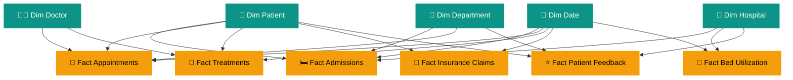

<div align="center">


<a href="https://github.com/harsh-mish">
  
</a>

<br/>

<p>
  
  
  
  
</p>

<p>
  
  
  
  
  
  
</p>

### 🩺 An end-to-end healthcare analytics project that monitors **hospital performance**, **patient activity**, **financial claims** and **treatment costs** through interactive Power BI dashboards.

</div>

<br/>

---

## 🧭 Table of Contents

| # | Section | # | Section |
|---|---------|---|---------|
| 1 | [🔍 Project Overview](#-project-overview) | 9 | [📈 Key Performance Indicators](#-key-performance-indicators) |
| 2 | [🎯 Objectives](#-project-objectives) | 10 | [🧮 Sample DAX Measures](#-sample-dax-measures) |
| 3 | [🛠️ Tools & Technologies](#️-tools--technologies) | 11 | [💡 Key Business Insights](#-key-business-insights) |
| 4 | [🏗️ Architecture & Workflow](#️-architecture--workflow) | 12 | [🎨 Design & UX Highlights](#-design--ux-highlights) |
| 5 | [📂 Dataset Overview](#-dataset-overview) | 13 | [📁 Project Structure](#-project-structure) |
| 6 | [🧩 Data Model](#-data-model) | 14 | [🚀 How to Use](#-how-to-use) |
| 7 | [📊 Dashboard Overview](#-dashboard-overview) | 15 | [📚 Skills Demonstrated](#-skills-demonstrated) |
| 8 | [📸 Screenshots](#-screenshots) | 16 | [🔮 Future Enhancements](#-future-enhancements) |

---

## 🔍 Project Overview

> **MediCare** turns scattered healthcare records into one clear, interactive story.

Hospitals generate huge volumes of data every day: **patients, admissions, appointments, treatments, doctors, departments, bed utilization and insurance claims**. On their own, these tables say very little. Together, in a well-structured model, they reveal how a healthcare organization is really performing.

This project brings all of these datasets into a **star-schema data model** and presents them through a **two-page Power BI report** built for decision makers.

### ✨ What the solution helps stakeholders understand

| 🏥 Operations | 💰 Finance | ⭐ Experience |
|---------------|-----------|---------------|
| Overall hospital performance | Insurance claim distribution | Patient ratings & feedback |
| Patient & admission trends | Claim approval performance | Department-wise satisfaction |
| Appointment & treatment activity | Treatment cost by category | Hospital-to-hospital comparison |
| Hospital-wise bed occupancy | Claimed vs approved amounts | Year-wise movement of ratings |

🎯 **Primary goal:** support **data-driven decision-making** and give clear visibility into healthcare operations.

---

## 🎯 Project Objectives

| 🎯 Objective | 📝 Description |
|--------------|----------------|
| 🧑‍🤝‍🧑 **Patient Analytics** | Monitor patient distribution and activity. |
| 🏥 **Hospital Performance** | Compare performance across hospitals. |
| 🛏️ **Admission Analysis** | Understand admission trends and patterns over time. |
| 📊 **Bed Utilization** | Monitor hospital bed occupancy and availability. |
| 💵 **Financial Analysis** | Analyse claim amounts and approved amounts. |
| 🧾 **Claim Management** | Track approved, pending, rejected and partially approved claims. |
| 💊 **Treatment Analysis** | Evaluate treatment costs by treatment category. |
| 🖱️ **Interactive Reporting** | Let users explore insights through slicers and cross-filtering visuals. |

---

## 🛠️ Tools & Technologies

| Technology | Purpose |
|------------|---------|
| 🟦 **Microsoft Fabric** | Data engineering and lakehouse environment |
| 🟨 **Power BI** | Interactive dashboard development |
| 🟪 **DAX** | Measures, calculations and KPIs |
| 🟦 **Power Query** | Data transformation and preparation |
| 🐬 **SQL** | Data querying and analysis |
| 🔥 **PySpark** | Data processing and transformation |

---

## 🏗️ Architecture & Workflow


### 🪜 Step-by-step

1. **Generate data:** create realistic synthetic healthcare datasets.
2. **Process & store:** transform the data with PySpark and keep it in a Fabric Lakehouse.
3. **Prepare:** clean and shape the tables with Power Query.
4. **Model:** build fact and dimension tables with proper relationships.
5. **Calculate:** write DAX measures for every KPI.
6. **Visualize:** design two polished report pages with slicers and cross-filtering.

---

## 📂 Dataset Overview

The project uses **generated (synthetic) healthcare data** that covers the main areas of hospital operations.

### 📚 Main Tables

| 📋 Table | 📝 Description |
|----------|----------------|
| 🧑 **Patients** | Patient demographics and registration information |
| 🏥 **Hospitals** | Hospital details and location information |
| 🏢 **Departments** | Hospital department information |
| 👨‍⚕️ **Doctors** | Doctor details and specializations |
| 🛏️ **Admissions** | Patient admission and discharge records |
| 📅 **Appointments** | Appointment details and waiting times |
| 💊 **Treatments** | Treatment types and treatment costs |
| 🧾 **Insurance Claims** | Insurance claim amounts and approval details |
| 🛌 **Bed Utilization** | Total, occupied and available beds |
| ⭐ **Patient Feedback** | Patient ratings and feedback categories |

### 🔢 Dataset at a Glance

<div align="center">

| 🧑 Patients | 📅 Appointments | 💊 Treatments | 🧾 Claims | 🛏️ Admissions | ⭐ Feedback | 🏥 Hospitals |
|:-----------:|:---------------:|:-------------:|:---------:|:-------------:|:-----------:|:------------:|
| **25K+** | **100K** | **75K** | **40K** | **35K** | **25K** | **8** |

</div>

> 📝 *Record counts represent the generated project datasets and may vary after filtering or data cleaning.*

---

## 🧩 Data Model

The report follows a **star schema**: fact tables hold the measurable events, and dimension tables provide the context used for slicing and filtering.

### 🟦 Fact Tables

| Fact Table | What it captures |
|------------|------------------|
| `Fact Admissions` | Admission and discharge events |
| `Fact Appointments` | Appointment activity and waiting times |
| `Fact Treatments` | Treatment types and costs |
| `Fact Insurance Claims` | Claimed and approved amounts, claim status |
| `Fact Bed Utilization` | Total, occupied and available beds |
| `Fact Patient Feedback` | Ratings and feedback categories |

### 🟩 Dimension Tables

| Dimension Table | Role |
|-----------------|------|
| `Dim Patient` | Who received care |
| `Dim Hospital` | Where care was delivered |
| `Dim Department` | Which department was involved |
| `Dim Doctor` | Who provided care |
| `Dim Date` | When it happened (year, month, etc.) |



> 🔗 The model is designed for **one-to-many relationships** and smooth **cross-filtering** between related healthcare entities.

---

## 📊 Dashboard Overview

The MediCare report is organized into **two analytical pages**.

### 🏠 Page 1 · Executive Overview

A high-level command center for hospital operations and performance.

| 🧩 Section | Details |
|------------|---------|
| **KPI Cards** | Total Patients · Total Admissions · Total Appointments · Total Treatments · Average Patient Rating |
| **Trend Visuals** | Admission Trends over time |
| **Comparison Visuals** | Hospital-wise Bed Occupancy Rate · Hospital Comparison |
| **Slicers** | Year · Hospital Name · Department Name · Insurance Type · Hospital Type |

### 💰 Page 2 · Financial & Claims Analysis

A focused view on claim performance and treatment costs.

| 🧩 Section | Details |
|------------|---------|
| **KPI Cards** | Total Claim Amount · Approved Amount · Total Treatment Cost · Claim Approval Rate |
| **Status Visuals** | Claims by Status · Claim Status Summary |
| **Financial Visuals** | Claim Amount vs Approved Amount · Monthly Claim Trends |
| **Cost Visuals** | Treatment Cost by Treatment Type |
| **Slicers** | Year · Month Name · Claim Status · Treatment Type |

---

## 📸 Screenshots

### 🏠 Executive Overview


### 💰 Financial & Claims Analysis


---

## 📈 Key Performance Indicators

| 📌 KPI | 🎯 Business Purpose | 📄 Page |
|--------|---------------------|---------|
| 🧑 **Total Patients** | Measures the overall patient population | Executive |
| 🛏️ **Total Admissions** | Tracks hospital admission activity | Executive |
| 📅 **Total Appointments** | Measures appointment volume | Executive |
| 💊 **Total Treatments** | Tracks treatment activity | Executive |
| ⭐ **Average Rating** | Measures patient satisfaction | Executive |
| 🛌 **Bed Occupancy Rate** | Evaluates hospital bed utilization | Executive |
| 💵 **Total Claim Amount** | Total value of insurance claims | Financial |
| ✅ **Approved Amount** | Amount approved by insurers | Financial |
| 📊 **Claim Approval Rate** | Proportion of approved claims | Financial |
| 🏷️ **Total Treatment Cost** | Evaluates treatment-related costs | Financial |

---

## 🧮 Sample DAX Measures

> 💡 Example patterns for the KPIs above. Adjust table and column names to match your model.

```DAX
Total Patients = DISTINCTCOUNT ( 'Dim Patient'[PatientID] )

Total Admissions = COUNTROWS ( 'Fact Admissions' )

Average Rating = AVERAGE ( 'Fact Patient Feedback'[Rating] )

Bed Occupancy Rate % =
DIVIDE (
    SUM ( 'Fact Bed Utilization'[OccupiedBeds] ),
    SUM ( 'Fact Bed Utilization'[TotalBeds] )
)

Total Claim Amount = SUM ( 'Fact Insurance Claims'[ClaimAmount] )

Approved Amount = SUM ( 'Fact Insurance Claims'[ApprovedAmount] )

Claim Approval Rate % =
DIVIDE (
    CALCULATE (
        COUNTROWS ( 'Fact Insurance Claims' ),
        'Fact Insurance Claims'[ClaimStatus] = "Approved"
    ),
    COUNTROWS ( 'Fact Insurance Claims' )
)

Total Treatment Cost = SUM ( 'Fact Treatments'[TreatmentCost] )
```

---

## 💡 Key Business Insights

The dashboard helps answer questions like these:

| # | ❓ Question | 🧩 Where to find it |
|---|------------|--------------------|
| 1 | Which hospital has the highest patient volume? | Executive Overview |
| 2 | How do admissions change over time? | Executive Overview |
| 3 | Which hospital has the highest bed occupancy rate? | Executive Overview |
| 4 | Which hospitals have comparatively higher admission activity? | Executive Overview |
| 5 | What proportion of claims are approved, pending or rejected? | Financial & Claims |
| 6 | How does the approved amount compare with the total claim amount? | Financial & Claims |
| 7 | Which treatment category contributes the highest treatment cost? | Financial & Claims |
| 8 | How do claim amounts change across different months? | Financial & Claims |
| 9 | How does patient feedback vary across departments? | Executive Overview |
| 10 | How can hospital performance be compared using multiple KPIs? | Both pages |

---

## 🎨 Design & UX Highlights

* 🎛️ **Slicer-driven exploration:** filter by year, hospital, department, insurance type, claim status and more.
* 🔄 **Cross-filtering visuals:** click any chart element to update the rest of the page.
* 🧭 **Clear two-page storytelling:** operations first, finance second.
* 🎨 **Consistent healthcare theme:** teal-based palette with KPI cards for quick scanning.
* 🧱 **Reusable star-schema model:** easy to extend with new facts or dimensions.

---

## 📁 Project Structure

```text
MediCare-Healthcare-Analytics/
│
├── 📊 Dashboard/
│   └── MediCare_Dashboard.pbix
│
├── 🖼️ Screenshots/
│   ├── Executive_Overview.png
│   └── Financial_Claims_Analysis.png
│
├── 📂 Data/
│   └── Dataset_Information.md
│
├── 🐬 SQL/
│   └── SQL_Queries.sql
│
├── 🔥 Notebooks/
│   └── Data_Transformation_Notebooks/
│
└── 📘 README.md
```

> 📝 *Include only the folders and files that are actually available in your repository.*

---

## 🚀 How to Use

1. 📥 **Clone** or download this repository.
2. 📂 Open the `Dashboard` folder.
3. ⬇️ Download the Power BI `.pbix` file.
4. 💻 Open it with **Microsoft Power BI Desktop**.
5. 🏠 Explore the **Executive Overview** page.
6. 💰 Navigate to **Financial & Claims Analysis**.
7. 🎛️ Use the slicers to filter and analyse the data.

```bash
git clone https://github.com/harsh-mish/MediCare-Healthcare-Analytics.git
```

> ⚠️ If your report uses external data sources or a Fabric workspace, those connections may need to be configured in your own environment.

---

## 📚 Skills Demonstrated

<div align="center">

| 🧠 Area | 🔧 What this project shows |
|---------|----------------------------|
| **Data Modeling** | Star schema, fact/dimension design, relationships |
| **DAX** | KPI measures, ratios, filter context |
| **Data Engineering** | PySpark transformations in a Fabric Lakehouse |
| **Power Query** | Cleaning and shaping data |
| **SQL** | Querying and validating data |
| **Dashboard Design** | Layout, slicers, storytelling, UX |
| **Domain Thinking** | Healthcare operations and insurance analytics |

</div>

---

## 🔮 Future Enhancements

- [ ] 🏥 Additional hospital operational analytics
- [ ] 👨‍⚕️ Doctor performance analysis
- [ ] ⭐ Advanced patient satisfaction analysis
- [ ] 🧾 More detailed insurance claim monitoring
- [ ] ⚡ Real-time healthcare data integration
- [ ] 🤖 Advanced predictive analytics
- [ ] 🔎 Enhanced drill-through reporting

---

## ⚠️ Disclaimer

This project is developed for **educational, portfolio and analytical demonstration purposes**.

The healthcare dataset used is **generated/synthetic** and does not represent actual patients, hospitals, medical records or insurance transactions.

The dashboard is **not intended** for clinical diagnosis, medical treatment decisions or real-world financial decisions.

---

## 👨‍💻 Author

<div align="center">

### Harsh Mishra

**Computer Science Engineering Graduate · Data Analytics · Data Engineering**

<p>
  <a href="https://github.com/harsh-mish">
    
  </a>
</p>

*Turning data into insights and insights into better decisions.* 💡

<br/>

### 🏥 MediCare · Better Health. Brighter Tomorrow.

**Thank you for exploring this project!**

⭐ If you find it useful, consider giving the repository a star.


</div>